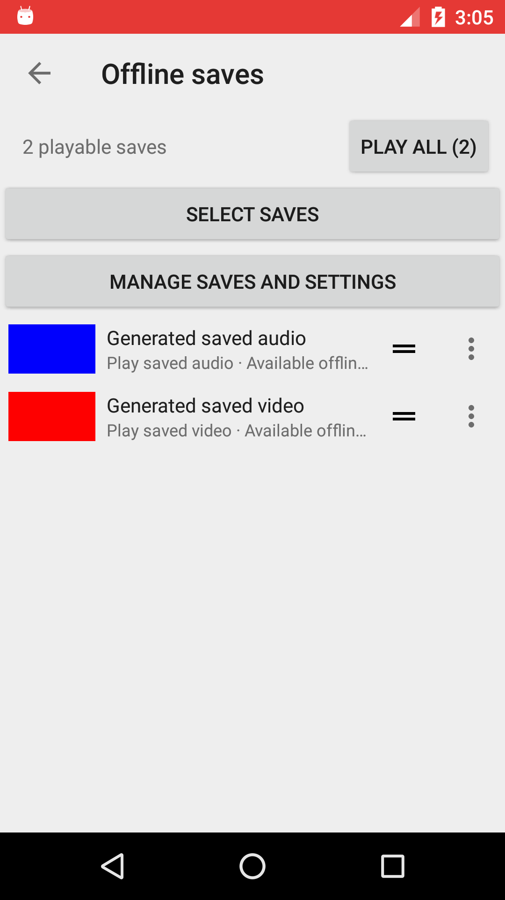

# Offline artwork and saved-video labels — candidate 1029

Candidate 1029 adds Korean video/audio labels and durable offline artwork on top
of PR #21 / APK1028. Release publication and main merging remain held pending
physical-phone acceptance. APK1027 remains **DO NOT INSTALL**.

## Exact artifact and corresponding source

| Item | Value |
| --- | --- |
| APK1029 build/product source | `0a6716beac7b82d90bcde78961ec5e37aa4e2234` |
| Baseline APK1028 product source | `99e644648235ae837034b6a11e0be473afc34458` |
| Candidate filename | `backtube-offline-thumbnails-0a6716b-1029-20261022.apk` |
| Package | `org.schabi.newpipe.continuous.testofflinelibrary20261011` |
| Version name / code | `0.29.1-backtube-offline-thumbnails-20261022` / `1029` |
| Bytes | `11547490` |
| APK SHA256 | `7b081bfbbdcc86a3fb8dce5ad60ee2309cc50d4f74d2d2cd33f004dc7958c71f` |
| Signing certificate SHA256 | `4fc26294d54b6c9adb276b0b3aab38592077fe28c9f3c64d93da5d9ff6bb5bbc` |

[Exact source](https://github.com/wnswlfhvkr-code/backtube/commit/0a6716beac7b82d90bcde78961ec5e37aa4e2234)
is available under the repository's existing GPL terms. Full GPL text, component
notices and all 12 original icon assets are preserved in the APK. The package,
valid signing certificate, permissions and minimum SDK match APK1028; versionCode
increases and 16 KiB zip alignment passes. Existing signing input was used
directly; no key contents were inspected/copied or new key created. A credential
indicator scan found no suspicious credential filename, private-key block or
recognized token marker; no matching values were printed or stored.

The artifact was built from a separate clean worktree of the product commit.
Its build branch normalizes to `testofflinelibrary20261011`, preserving the
existing package suffix, with `versionCodeOverride=1029` and
`versionNameSuffix=-backtube-offline-thumbnails-20261022`. Later geometry-test and
verification-documentation changes do not modify product sources or APK bytes.
APK1026's source remains `baf499bac357399d60c36bbdd47de667902ef938`;
`cb89c858...` must not be described as its build source.

## Behavior

- Ready rows, accessibility play actions and fresh playback metadata distinguish
  **영상 저장본 재생** from **오디오 저장본 재생**. Pending entries distinguish
  영상 저장본 and 오디오 저장본. English resources also distinguish the types.
- Existing Coil memory/disk entries are copied without a network request. The
  save dialog supplies known thumbnail candidates; old saves consult existing
  InfoCache and Room metadata, including a Room candidate after cache misses.
- Missing video covers can be generated from the READY owned `.media` file on
  one background worker. Retain/release protects active readers, and generation
  checks plus atomic publication prevent deletion/retry races.
- JPEG sidecars are at most 320 pixels on either edge and 128 KiB each, within a
  32 MiB artwork budget. Older artwork may be evicted and regenerated. Media bytes,
  durable save records and shelf order are independent of these optional images.
- API27+ uses scaled frame extraction. API23–26 refuses unknown dimensions and
  frames above 480,000 source pixels before full-frame extraction; such legacy
  saves use an existing cached cover or a placeholder. No source URL is passed
  to the retriever and no download/extractor fallback is introduced.
- Binding cancels previous work and Coil requests on rebind/recycle/destruction.
  Entry identity and binding tokens prevent a late image from reaching another
  row. Corrupt/unreadable images retain a placeholder; cache failures still allow
  owned-video fallback. Deleting a save removes its artwork while an active media
  reader retains the existing media-file lifetime behavior.
- Owned local image URIs reach individual, all and selected queues, restored
  detail metadata, player artwork and the playback entry screen. Source creation
  never waits for artwork. A late cover refreshes only the currently active
  source's artwork/listeners, without seeking or rebuilding playback sources.

PR #21's video-containing local queue routing, audio-only background behavior,
finite queue order, listening mode and recovery correction are preserved.

## Verification

- Genuine RED: persisted-artwork metadata test failed before implementation.
  A device regression also reproduced the eight-InfoCache-misses/Room-candidate
  bug (expected one local image, observed zero) before its correction.
- App JVM: **545 tests / 87 suites**, zero failures/errors/skips.
- Shared canonical JVM UI: **14 tests / 9 suites**, zero failures/errors/skips.
  Android-host tests were compiled; no Android-host runtime-pass claim is made.
- Debug/test and continuous APK assembly, Android instrumentation compilation,
  Checkstyle, Ktlint, dependency order and whitespace checks pass.
- Lint: **0 Error / 0 Fatal / 346 Warning**. One additional warning is a KTX style
  suggestion for the explicitly bounded bitmap scaling call.
- Independent read-only SPEC and QUALITY review: **PASS** after correction of
  the cache-candidate finding. The reviewer did not execute tests.
- With cloud API23 radios disabled, the final generated-artwork suite passed
  **5/5**: actual shelf colours/labels/reordering, persisted metadata, saturated
  worker/nonblocking source creation, Room fallback, corrupt-media placeholders,
  local video-frame extraction and unchanged media bytes/order.
- Generated WebM VP8/Vorbis playback passed **3/3**: rendered video and decoded
  audio, selected audio→video transition, audio-only background output, active
  player artwork, listening-mode toggles, actual controller expansion and
  preserved pause/position/gain/timer. Extractor requests remain zero.
- A further UI check waits for actual screen rectangles to reach their reordered
  positions and for rendered frames before capture. The settled generated-media
  screenshot was inspected: the two images and labels remain distinct, correctly
  ordered and nonoverlapping. The image below contains only generated test data.

Runtime instrumentation used an isolated debug package with the identical
product sources of APK1029. The headless device verifies audio decoder buffers,
not human audibility. Only generated CC0 media and generated solid-colour images
were used; no user's PC, account data or external original media was accessed.

## Actual candidate update check and limits

The exact APK1028 was installed into a fresh cloud package, then the exact
APK1029 was installed as an update without uninstalling or granting runtime
permissions. A generated legacy-format READY video fixture survived with
identical saved metadata and media SHA256. Installed versionCode is **1029**;
the candidate shelf launches and generates a valid **320×180** local JPEG.

The initial external-import intent harness did not produce a READY record within
its timeout. The upgrade check therefore used a generated valid legacy-store
fixture; it does **not** establish normal import/download end-to-end behavior.
The continuous candidate's audio/video decoders were not instrumented directly.
Physical-phone acceptance, real network download/DASH mux, and complete
Back/task-removal coverage remain **NOTRUN**. The earlier cloud API23 H.264 native
decoder SIGILL limitation has not been resolved or claimed passing by this change;
the successful runtime codec path here is WebM VP8/Vorbis.

Install as an update to the existing matching-package app, preserving app data.
Verify saved video picture+sound, audio-only/background behavior, artwork and
resume behavior on the actual phone before deciding to release. Do not install
APK1027. No release/tag publication or main merge was performed.

Machine-readable evidence: [summary.json](evidence/offline-thumbnails-2026-10-22/summary.json).
